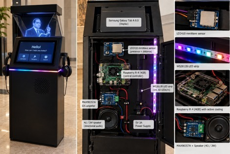
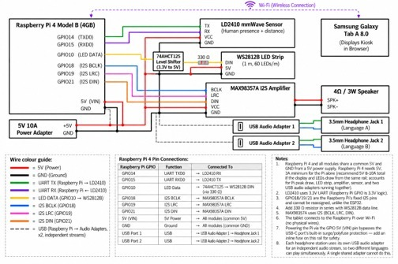

# Ambedkar Digital Heritage Archive

<p align="center">
  <strong>Smart India Hackathon 2026 · Preserving Constitutional Legacy Through AI</strong><br/><br/>
  A full-stack, AI-powered interactive kiosk &amp; web archive preserving the writings, speeches, and constitutional legacy of Dr. B. R. Ambedkar — queryable in English, Hindi, and Kannada.
</p>

<p align="center">
  
  
  
  
  
  
</p>

---

## ◈  The Vision

India holds a priceless heritage — but much of it sits in scanned PDFs and institutional vaults, unreachable by the public. We set out to answer one question:

> **"What if you could walk up to a kiosk and *talk* to a century of historical documents?"**

The **Ambedkar Digital Heritage Archive** is our answer. It is not just a website. It is an intelligent, multi-modal public kiosk — part archive, part research assistant, part living monument — built to make Dr. Ambedkar's life's work discoverable, citable, and alive for every citizen.

---

## [ I ]  Hardware — The Physical Kiosk

The system runs entirely on off-the-shelf, cost-effective hardware designed for public deployment in museums, libraries, and government buildings.

### Kiosk Overview

The kiosk features a holographic-effect display, gesture-aware proximity sensing, multi-language audio output through two independent headphone channels, and ambient LED feedback — all orchestrated by a single Raspberry Pi 4.

<p align="center">
  
  <br/>
  <sub><em>Left: Kiosk exterior with holographic display &amp; directional speaker &nbsp;·&nbsp; Centre: Internal component layout &nbsp;·&nbsp; Right: Component closeups (LD2410, WS2812B, Raspberry Pi 4, MAX98357A)</em></sub>
</p>

### Component Manifest

| Component | Model | Role |
|---|---|---|
| **Main Controller** | Raspberry Pi 4 Model B (4 GB) | Runs all logic, audio routing, sensor I/O, and display control |
| **Primary Display** | Samsung Galaxy Tab A 8.0 | Renders the full web archive UI in browser (Wi-Fi) |
| **Proximity Sensor** | LD2410 mmWave Radar | Detects visitor presence & distance (UART protocol) |
| **Ambient Lighting** | WS2812B LED Strip (1m, 60 LED/m) | Visual feedback — idle pulse, active glow, alert states |
| **Audio Amplifier** | MAX98357A I²S Class-D Amp | Drives 4Ω/3W directional speaker (Language A) |
| **Directional Speaker** | 4Ω / 3W | Primary language audio output |
| **Headphone Jack 1** | 3.5mm via USB Audio Adapter 1 | Language A private listening |
| **Headphone Jack 2** | 3.5mm via USB Audio Adapter 2 | Language B independent stream |
| **Power Supply** | 5V 10A Adapter | Powers all modules via common GND rail |
| **Level Shifter** | 74AHCT125 (3.3V → 5V) | Converts Pi GPIO logic for WS2812B LED data line |

### GPIO & Wiring Map

```
Raspberry Pi GPIO  │  Function     │  Connected To
───────────────────┼───────────────┼─────────────────────────────────────────
GPIO14 (TXD0)      │  UART TX      │  LD2410 TX (mmWave Sensor)
GPIO15 (RXD0)      │  UART RX      │  LD2410 RX (mmWave Sensor)
GPIO18             │  LED Data     │  74AHCT125 Level Shifter → WS2812B DIN
GPIO21             │  I²S LRC      │  MAX98357A LRC
GPIO18             │  I²S BCLK     │  MAX98357A BCLK
GPIO21             │  I²S DIN      │  MAX98357A DIN (audio data)
5V (VIN)           │  Power Rail   │  All modules (common 5V)
GND                │  Ground Rail  │  All modules (common GND)
USB Port 1         │  USB          │  Audio Adapter 1 → 3.5mm Jack (Language A)
USB Port 2         │  USB          │  Audio Adapter 2 → 3.5mm Jack (Language B)
```

<p align="center">
  
  <br/>
  <sub><em>Full circuit diagram — GPIO pin assignments, I²S audio bus, UART sensor link, WS2812B LED data line, and dual USB audio adapter routing</em></sub>
</p>

> **Key design insight:** The two USB audio adapters produce **fully independent, simultaneous audio streams**. A visitor on headphone set 1 hears English narration while another on set 2 hears Hindi — no mixing, no cross-talk. The `MAX98357A` drives the directional speaker via the Pi's hardware I²S bus, bypassing the CPU for ultra-low-latency audio. The LD2410 mmWave sensor wakes the kiosk from idle when a visitor approaches — no button press required.

---

## [ II ]  Software Architecture

The entire stack runs as a **Next.js 16 application** hosted on **Firebase**, with a local kiosk server deployable directly on the Raspberry Pi. Cloudflare Workers support is planned for future edge deployments.

```
┌──────────────────────────────────────────────────────────────────┐
│                       BROWSER / KIOSK UI                         │
│  WebGL 3D Hero  ·  Timeline  ·  Research  ·  Media Archive       │
├──────────────────────────────────────────────────────────────────┤
│                       NEXT.JS API LAYER                          │
│   /api/archive/supplied  ·  /api/archive/translations            │
├─────────────────┬────────────────────┬───────────────────────────┤
│   PAGE INDEX    │   HYBRID SEARCH    │   OKF PIPELINE            │
│  Per-page chunks│  BM25 + TF-IDF SVD │  Rerank + Verify + Cite   │
│  (OCR + Native) │  48-dim vectors    │  + RAG Extractive Output  │
└─────────────────┴────────────────────┴───────────────────────────┘
```

---

## [ III ]  Core AI Concepts — Explained for Judges

### §1 · Page Index — *Every Page is a Searchable Unit*

Traditional search indexes whole documents. We go deeper: the **Page Index** treats **every single PDF page as an independent, addressable knowledge unit**.

When a document enters the archive:

1. **Native Text Extraction** — PDF text layers are read with zero information loss
2. **OCR Processing** — `Tesseract.js` processes scanned/image-only pages with no selectable text
3. **Page Record** — Each page is stored with `documentId`, `pageNumber`, `extractionMethod`, and raw `text`

**Why this matters:**

When a judge searches *"Constituent Assembly debates on fundamental rights"*, the system returns **Page 47 of the Constitution manuscript** — not just "the Constitution PDF". The Document Reader opens *at that exact page* with the search term highlighted inline.

```
User Query
    │
    ▼
Query Normalisation
    │
    ▼
BM25 Keyword Match + Semantic Vector Match
    │
    ▼
Page Index Lookup → Exact Page Number Retrieved
    │
    ▼
Document Reader opens to that page, term highlighted
```

> The Page Index also powers the **Document Reader's Time Machine tab**: each page shows its extraction method, translation status, and relationship context — giving researchers a full provenance trail per page, not per document.

---

### §2 · OKF — *Open Knowledge Framework*

OKF is our **citation integrity and open metadata layer** — the ethical backbone of the archive.

Every document record in the archive carries a structured OKF profile:

| OKF Field | What It Does |
|---|---|
| **Dublin Core Metadata** | Creator, Date, Collection, Rights, Language |
| **Provenance Label** | "User-supplied PDF", "Government source", etc. |
| **SHA-256 Fingerprint** | Cryptographic proof the file has not been altered |
| **Extraction Report** | Native pages / OCR pages / Unreadable pages |
| **Rights Statement** | Explicit reuse terms, or an honest "rights not verified" flag |
| **Reference ID** | Local catalogue ID clearly distinguished from institutional accession numbers |

The full catalogue is **downloadable as open JSON or CSV** — following Open Knowledge Foundation principles that public heritage data must be machine-readable and freely accessible. This enables third-party researchers, developers, and institutions to build on our work without lock-in.

```
OKF Principle: No document is ever cited without its source.
               No claim is ever made without evidence.
               No rights are ever assumed without verification.
```

> Judges can download the live open catalogue directly from the **Knowledge Engine** panel inside the application.

---

### §3 · RAG — *Retrieval-Augmented Generation*

Our **Research module** implements a fully evidence-grounded RAG pipeline — six visible, interactive stages:

```
Stage 1 │ Load Indexed Sources    → Pull the Page Index into the retrieval context
Stage 2 │ Normalize Query         → Correct spelling, expand query synonyms
Stage 3 │ Hybrid Search           → BM25 keyword scoring + 48-dim TF-IDF/SVD semantic vectors
Stage 4 │ Rerank Passages         → Score by relevance, entity overlap, source type, and page metadata
Stage 5 │ Verify Citations        → Range-check page numbers, validate document IDs against the index
Stage 6 │ Build Evidence Response → Return retrieved passages with exact, clickable citations
```

**What sets our RAG apart — Extractive, Not Generative:**

The system **will never fabricate a quote or invent a historical claim**. If evidence doesn't exist in the indexed documents, it returns *"Insufficient evidence in indexed sources"* — not a hallucinated answer.

This is non-negotiable for a **constitutional heritage archive** where every word attributed to Dr. Ambedkar must be verifiably traceable to its source page.

**Conversational context:** Follow-up queries remember the previous query's entity graph. A visitor can ask *"What did he write about untouchability?"* and then immediately *"Which volume?"* — the system resolves the pronoun and entity reference automatically.

**Voice input:** The research interface supports Web Speech API for hands-free kiosk interaction across all three supported languages.

---

## [ IV ]  Full Feature Set

| # | Feature | Description |
|---|---|---|
| 01 | **WebGL 3D Hero Scene** | Physically-lit 3D book geometry with Dr. Ambedkar's portrait, environment maps, and damped camera movement |
| 02 | **Document Reader** | Full PDF viewer: zoom, rotation, find-in-page, bookmarks (localStorage), read-aloud TTS |
| 03 | **Page Index Navigation** | Deep-link to any retrieved page; bookmark strip with persistent storage |
| 04 | **Research / RAG Engine** | 6-stage live RAG with voice input, source passage highlighting, feedback (+/-), citation copy |
| 05 | **Knowledge Graph** | Interactive entity-relationship graph linking people, documents, and timeline events |
| 06 | **Timeline Journey** | Source-linked chronology with topic, type, and date-range filters; click to open source page |
| 07 | **Media Archive** | Audio player with timestamped annotations, playback speed control, and empty-state honesty |
| 08 | **Knowledge Engine** | Animated 8-node ingestion constellation — shows the entire OKF pipeline visually |
| 09 | **Multilingual UI** | English · हिन्दी · ಕನ್ನಡ — navigation, labels, and human-reviewed page translations |
| 10 | **Kiosk Mode** | Full-screen, enlarged controls, 90-second inactivity auto-reset, mmWave wake-on-approach |
| 11 | **Accessibility** | ARIA roles, keyboard navigation, skip links, reduced-motion mode, contrast controls |
| 12 | **Open Exports** | Dublin Core JSON & CSV catalogue download for institutional reuse |

---

## [ V ]  Project Structure

```
digital-heritage-archive/
├── app/
│   ├── page.tsx                       # Application entry
│   ├── globals.css                    # Design system: archival palette, typography, animations
│   └── api/archive/                   # Secure document serving & translation endpoints
├── src/
│   ├── components/
│   │   ├── ArchiveExperience.tsx      # Root navigator: kiosk / entrance / explorer states
│   │   ├── DocumentReader.tsx         # Page Index reader — heart of document access
│   │   ├── Research.tsx               # 6-stage RAG query interface with voice
│   │   ├── KnowledgeEngine.tsx        # 8-node OKF + ingestion pipeline visualiser
│   │   ├── KnowledgeGraph.tsx         # Entity graph navigation
│   │   ├── TimelineJourney.tsx        # Source-linked chronology (largest component)
│   │   ├── MediaArchive.tsx           # Audio player with timestamps
│   │   └── WordsBook.tsx              # Interactive writings explorer
│   ├── knowledge/
│   │   ├── hybrid.ts                  # Hybrid BM25 + semantic retrieval engine
│   │   ├── semantic.ts                # TF-IDF/SVD vector index & Page volume API
│   │   └── pdf-runtime.ts             # Lazy PDF.js loader (code-split)
│   ├── scene/
│   │   ├── HeroScene.tsx              # WebGL R3F scene — book, portrait, environment
│   │   └── MuseumFallback.tsx         # CSS3D fallback when WebGL is unavailable
│   ├── data/archive.ts                # Document catalogue, graph, timeline, engine stages
│   ├── services/index.ts              # Service adapters & backend boundary
│   └── config/i18n.ts                 # EN / HI / KN string table
├── public/
│   ├── assets/ambedkar-portrait.png   # SHA-256 verified, never regenerated or altered
│   └── corpus/                        # Document manifest & timeline dataset (JSON)
└── docs/
    ├── INTEGRATION.md                  # Backend connection contracts
    └── PORTABLE_HOSTING.md            # Supabase, Vercel, Node deployment guides
```

---

## [ VI ]  Running Locally

**Prerequisites:** Node.js >= 22.13 · pnpm 11

```sh
# Install dependencies
pnpm install --frozen-lockfile

# Start development server
pnpm dev
# --> http://localhost:3000
```

No API key or environment variable is required for the demo. `.env.example` documents future integration settings.

**Production build:**
```sh
pnpm exec tsc --noEmit   # Full type-check
pnpm build               # Next.js production build
```

---

## [ VII ]  Data Integrity & Archival Honesty

| Commitment | Implementation |
|---|---|
| Portrait integrity | `ambedkar-portrait.png` is byte-identical to the supplied image — SHA-256 verified, never regenerated or facially animated |
| No hallucinations | RAG returns *"Insufficient evidence"* rather than fabricating quotes |
| Clear demo labelling | Every reader page shows **DEMO ARCHIVAL PAGE** until connected to a verified institutional backend |
| Honest empty states | No fake video content — video section presents an honest empty state |
| ID transparency | `REF-` = local catalogue IDs · `DEMO-` = interface examples · neither are institutional accession numbers |
| Rights transparency | Every document carries an explicit rights statement or an honest "not verified" flag |

---

## [ VIII ]  Performance & Accessibility

- **Lazy loading:** R3F and CSS3D scene modules load behind an immediate portrait fallback — first paint is instant
- **WebGL guard:** DPR capped at 1.5, drops to 1 under GPU load — no expensive post-processing stack
- **Reduced motion:** Demand rendering stops drawing once transforms settle; offscreen scenes pause
- **Mobile:** Recomposed stable view, no parallax — the full archive works on the Samsung Tab A display
- **Accessible primitives:** Dialogs, tabs, sliders and selects use Radix UI accessible components
- **Kiosk touch:** All interactive targets are enlarged in kiosk mode; fullscreen is requested on entry

---

## [ IX ]  Tech Stack

| Layer | Technology |
|---|---|
| **Framework** | Next.js 16 · React 19 · TypeScript 5.9 |
| **3D Rendering** | Three.js 0.186 · React Three Fiber · @react-three/drei |
| **PDF Engine** | `pdfjs-dist` 6.3 (canvas render + native text layer extraction) |
| **OCR** | `Tesseract.js` 7.0 (client-side, zero server dependency) |
| **Search & Retrieval** | Custom BM25 · TF-IDF/SVD 48-dim vector index (hybrid) |
| **Database** | Drizzle ORM 0.45 · PostgreSQL (Neon / Supabase) |
| **Automation** | n8n webhook ingestion pipeline |
| **Styling** | Vanilla CSS · Cormorant Garamond · EB Garamond |
| **Hosting (Current)** | Firebase Hosting |
| **Hosting (Future)** | Cloudflare Workers · Wrangler 4 · Vinext adapter |
| **Hardware** | Raspberry Pi 4 · LD2410 mmWave · WS2812B LEDs · MAX98357A I²S amp |

---

## [ X ]  Deployment Options

| Environment | Command |
|---|---|
| Local dev | `pnpm dev` |
| Firebase Hosting | `firebase deploy` |
| Cloudflare Workers *(planned)* | `pnpm build:cloudflare && pnpm start:cloudflare` |
| Portable (Vercel / Node) | `pnpm build:portable && pnpm start:portable` |

See [`docs/PORTABLE_HOSTING.md`](docs/PORTABLE_HOSTING.md) for Google Sign-In, Supabase storage, and generic Node hosting options.

---

## [ XI ]  Team

Built for **Smart India Hackathon 2026** — dedicated to making constitutional heritage accessible to every citizen of India.

---

> *"Education is the most powerful weapon which you can use to change the world."*
> — **Dr. B. R. Ambedkar**
